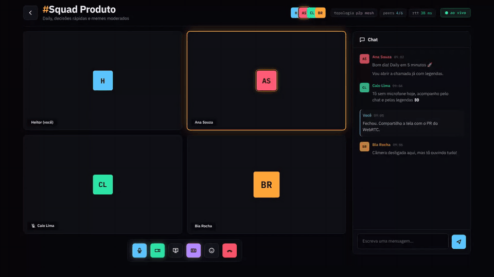
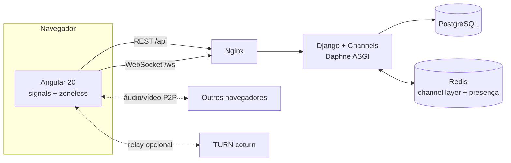

# Conecta

**Salas de conversa com chat de texto, voz e vídeo em tempo real** — com legendas ao vivo,
indicador de quem está falando, reações que voam pela tela e compartilhamento de tela.




🎬 [Ver o vídeo em Full HD](docs/media/conecta-demo.mp4)

> 📖 Quer entender as decisões técnicas e os desafios do projeto? Leia
> [**Sobre o projeto**](docs/SOBRE-O-PROJETO.md).

## ✨ Destaques

| Recurso | Como funciona |
| --- | --- |
| 💬 **Chat em tempo real** | WebSocket (Django Channels), histórico paginado por cursor, agrupamento de mensagens e indicador de digitação |
| 🎙️ **Voz e 📹 vídeo em grupo** | WebRTC ponto a ponto em malha (até 6 pessoas por padrão), com o padrão *perfect negotiation* para evitar colisões de oferta |
| 📝 **Legendas ao vivo** | A fala é transcrita no próprio navegador (Web Speech API, pt-BR) e o texto é compartilhado com todos da chamada |
| 🟢 **Quem está falando** | Análise de volume via Web Audio API acende um anel neon no participante ativo |
| 🚀 **Reações flutuantes** | Emojis enviados por qualquer participante sobem pela tela de todos |
| 🖥️ **Compartilhar tela** | Troca a trilha de vídeo sem renegociar a conexão (`RTCRtpSender.replaceTrack`) |
| ✉️ **Contas seguras** | Cadastro com e-mail e senha, confirmação de e-mail por link e recuperação de senha com link de uso único |
| 🔁 **Resiliência** | Reconexão automática com *backoff* exponencial, renovação transparente do JWT e presença multi-aba |
| 🎨 **Visual "Grafite Pro"** | Grafite quase preto, tipografia técnica (IBM Plex) e cores vivas com função; botões com onda de toque, brilho e anel de pulso, e atalhos de teclado na chamada (M, V, S, C, R) |

## 🏗️ Arquitetura



- **HTTP (DRF):** autenticação JWT, salas, histórico de mensagens e configuração ICE.
- **WebSocket (Channels):** mensagens, presença, digitação e **sinalização WebRTC**. O servidor só
  encaminha `offer`/`answer`/`ice`; a mídia trafega direto entre os navegadores.
- **Redis:** distribui eventos entre processos e guarda a presença de cada sala, permitindo escalar
  horizontalmente.

## 🚀 Como rodar

### Com Docker (recomendado)

```bash
cp .env.example .env
docker compose up --build
```

Acesse **http://localhost:8080** e crie uma conta. O e-mail de confirmação chega na caixa de
entrada de desenvolvimento em **http://localhost:8025** (Mailpit). Confirme e abra a mesma sala em
duas abas (ou em outro dispositivo) para testar a chamada.

> Câmera e microfone só funcionam em `localhost` ou HTTPS — exigência dos navegadores.
> Para usuários em redes diferentes, ative o TURN: `docker compose --profile turn up` e preencha
> `TURN_URLS` no `.env` (ex.: `turn:SEU_IP:3478`).

### Sem Docker

**Backend** (Python 3.12+):

```bash
cd backend
python -m venv .venv && source .venv/bin/activate
pip install -r requirements-dev.txt
python manage.py migrate
python manage.py runserver   # Daphne atende HTTP + WebSocket
```

Sem `DATABASE_URL` e `REDIS_URL` o projeto usa SQLite e um channel layer em memória — ótimo para
desenvolvimento rápido.

**Frontend** (Node 20+):

```bash
cd frontend
npm install
npm start                    # http://localhost:4200 com proxy para /api e /ws
```

## 🔐 Contas e e-mail

| Fluxo | Como funciona |
| --- | --- |
| **Cadastro** | Nome, e-mail e senha (mínimo 8 caracteres, validada contra senhas comuns). A senha é guardada como hash. A conta já entra logada e recebe o e-mail de confirmação. |
| **Login** | E-mail e senha geram um token de acesso (30 min) e um de renovação (7 dias), renovados automaticamente. |
| **Confirmação de e-mail** | Link assinado, válido por 3 dias, que deixa de valer se o e-mail da conta mudar. Sem confirmar, a pessoa vê as salas mas não cria, não conversa e não liga. Dá para reenviar o link pelo site. |
| **Recuperação de senha** | "Esqueci minha senha" envia um link válido por 2 horas e de uso único. A resposta é a mesma exista ou não a conta, para não revelar quem está cadastrado. |
| **Proteção contra abuso** | Envios de e-mail limitados por pessoa/IP; tentativas de login limitadas. |

Endpoints: `POST /api/auth/register/`, `token/`, `token/refresh/`, `verify-email/`,
`verify-email/resend/`, `password-reset/`, `password-reset/confirm/` e `GET /api/auth/me/`.

Para enviar e-mails de verdade em produção, preencha `EMAIL_HOST`, `EMAIL_PORT`,
`EMAIL_HOST_USER`, `EMAIL_HOST_PASSWORD` e `EMAIL_USE_TLS` com o SMTP do seu provedor e ajuste
`FRONTEND_URL` para o endereço público do site.

## 🧪 Testes e qualidade

```bash
cd backend && pytest -q && ruff check .
cd frontend && npm run build   # strictTemplates + TypeScript estrito
```

O pipeline do GitHub Actions roda lint, verificação de migrations, testes do backend contra
PostgreSQL real e o build de produção do frontend.

## 📡 Protocolo do WebSocket

Conexão: `ws(s)://<host>/ws/rooms/<slug>/?token=<access_jwt>`

| Direção | Evento | Payload |
| --- | --- | --- |
| → | `chat.message` | `{content, clientId}` |
| → | `chat.typing` | `{isTyping}` |
| → | `call.join` / `call.leave` | `{media: {audio, video}}` / `{}` |
| → | `call.media` | `{media}` |
| → | `call.reaction` | `{emoji}` |
| → | `call.caption` | `{text, final}` |
| → | `rtc.offer` / `rtc.answer` / `rtc.ice` | `{to, sdp}` / `{to, candidate}` |
| ← | `session.ready` | `{peerId, peers}` |
| ← | `presence.joined` / `presence.left` | `{peer}` / `{peerId}` |
| ← | `call.accepted` | `{participants}` |
| ← | `call.joined` / `call.left` / `call.media` | — |
| ← | `rtc.*` | `{from, ...}` |
| ← | `error` | `{code, detail}` |

Os tipos ficam em `frontend/src/app/core/models.ts` como **uniões discriminadas**, então o
compilador garante que cada evento é tratado com o formato certo.

## 🗂️ Estrutura

```
backend/
  config/            settings, ASGI (HTTP + WebSocket), URLs
  apps/accounts/     usuário (login por e-mail), cadastro, confirmação de e-mail, recuperação de senha
  apps/chat/         salas, mensagens, consumer WebSocket, presença, middleware JWT
frontend/
  src/app/core/      modelos, auth (JWT + interceptor), API, socket, WebRTC
  src/app/shared/    botão personalizado, ícones, avatar, toasts
  src/app/features/  entrar, esqueci/redefinir senha, confirmar e-mail, salas, sala (chamada + chat)
```

## 🛣️ Próximos passos

- SFU (ex.: LiveKit/mediasoup) para chamadas com dezenas de participantes
- Envio de arquivos e imagens no chat
- Salas privadas com convite
- Gravação de chamadas

## 📄 Licença

[MIT](LICENSE)
